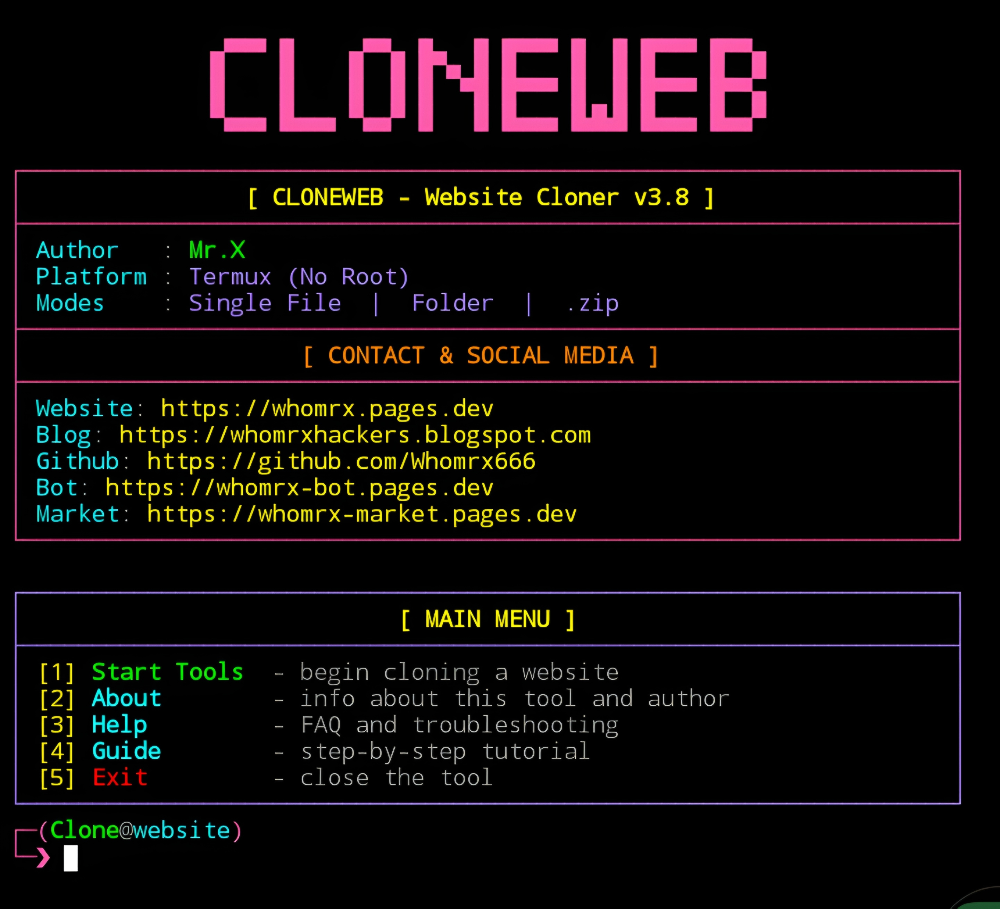

# CloneWeb


<p align="center">
  <strong>Cyberpunk Neon Edition – Website Cloner for Termux (No Root)</strong><br>
  <em>"Clone, learn, recode – every site is a lesson." – Mr.X</em>
</p>

## Introduction
CloneWeb is a powerful **website cloner** built for Termux (No Root), Linux, and Windows that converts any live website into a fully self-contained local copy. Unlike typical scrapers, CloneWeb preserves HTML, CSS, JS, images, and fonts while keeping every source file **READABLE** so you can study, edit, or recode the result for learning and development purposes. With its sleek **cyberpunk neon terminal interface**, CloneWeb offers three flexible save modes (Single File, Folder, or .zip), built-in local preview server, auto-responsive injection, and smart User-Agent presets.

## Installation
```bash
$ pkg update -y && pkg upgrade -y
$ pkg install git python -y
$ git clone https://github.com/Whomrx666/Cloneweb.git
$ cd Cloneweb
$ python3 install.py
```

## Run manually
```
$ python3 cloneweb.py
```

> **Note:** For preview mode on Android, install `termux-api` package to enable automatic browser opening via `termux-open-url`.

## Features
- **Three Save Modes** – Single File HTML (all embedded), Separate Folder (organized subdirs), or Folder as .zip (portable archive).
- **Readable Output** – HTML, CSS, JS kept as plain text with source labels – no obfuscation.
- **Responsive by Design** – Auto viewport meta injection plus a safety net CSS for perfect mobile rendering.
- **Complete Asset Handling** – CSS `@import`, `srcset`, lazy-load, inline styles, web fonts, media – all processed.
- **User-Agent Presets** – Choose Mobile or Desktop UA per clone to match target site's layout.
- **Built-in Preview Server** – Instant localhost HTTP server with auto browser launch after cloning.
- **Anti-Break Escaping** – Smart escape of `</script>` and `</style>` to prevent HTML injection issues.
- **Cyberpunk Neon UI** – Beautiful ANSI-colored terminal with animations, boxed layouts, and clean prompts.
- **Smart Charset Detection** – Auto-detects encoding from headers, meta tags, and content.
- **No Root Required** – Runs flawlessly on Termux Android without any special permissions.

## Modes Overview
| # | Mode | Description |
|---|------|-------------|
| 01 | Single File HTML | All assets (CSS, JS, images, fonts) embedded as inline/data URI in one portable HTML file |
| 02 | Separate Folder | HTML at root with organized subdirs: css/, js/, images/, fonts/, media/, icons/, other/ |
| 03 | Folder as .zip | Same as Separate Folder but packed into a single .zip archive for easy sharing |

## Main Menu Options
| # | Option | Description |
|---|--------|-------------|
| 01 | Start Tools | Begin cloning a website with full mode selection |
| 02 | About | Info about the tool, features, and author |
| 03 | Help | FAQ and troubleshooting for common issues |
| 04 | Guide | Step-by-step tutorial for beginners |
| 05 | Exit | Close the tool with stylish goodbye animation |

## Asset Processing Capabilities
| Asset Type | Handling |
|------------|----------|
| CSS Stylesheets | Downloaded, `@import` inlined, `url()` references rewritten |
| JavaScript | Downloaded with source URL comments for readability |
| Images | Handled via `src`, `srcset`, `data-src`, lazy-load attributes |
| Web Fonts | woff, woff2, ttf, otf, eot – auto-fetched from CSS |
| Media | Video (mp4, webm, ogv), Audio (mp3, wav, m4a, flac, opus) |
| Icons | Favicon, apple-touch-icon, mask-icon – all preserved |
| Inline Styles | `style="url(...)"` attributes rewritten correctly |
| Meta Tags | OpenGraph, Twitter Card images auto-processed |

## Instructions
1. **Install** the tool using the commands above.
2. **Run** `python3 cloneweb.py` after installation.
3. **Choose mode** – select Single File, Folder, or Folder as .zip.
4. **Enter target URL** – example: `https://example.com` (https:// added automatically if missing).
5. **Select UA mode** – Mobile (recommended) or Desktop layout.
6. **Choose save location** – enter path or press Enter for default (`/sdcard/` on Android).
7. **Name the output** – file name for Single mode, folder name for Folder mode.
8. **Wait for clone to finish** – watch per-asset progress in real-time.
9. **Preview instantly** – answer `y` to launch built-in local server and open in browser.
10. **Edit & recode** – open the output in any text editor; every block is labeled with its source URL.

## Observation
This tool is intended for **educational and development purposes only**. Always respect the copyright, terms of service, and robots.txt of any website you clone. Do not use the output to redistribute copyrighted material or impersonate a live website. The author assumes no responsibility for misuse or damage caused by this tool.

### Original Author
<a href="https://github.com/Whomrx666"></a>

### <<< If you copy, then give me the credits >>>

## CONNECT WITH ME :

[](https://whomrx.pages.dev)<br>
[](https://whomrxhackers.blogspot.com)<br>
[](https://twitter.com/whomrx666)<br>
[](https://wa.me/6285926601133?text=Halo%2C%20Mr.X)<br>
[](https://www.facebook.com/whomrx.666)<br>
[](https://t.me/Whomr_X)<br>
[](mailto:whomrx666@gmail.com)<br>
[](https://www.tiktok.com/@whomr.x)<br>

**If you want to donate, click on the button**<br>
<a href="https://saweria.co/whomrx"></a>

---

<p align="left">
  
</p>